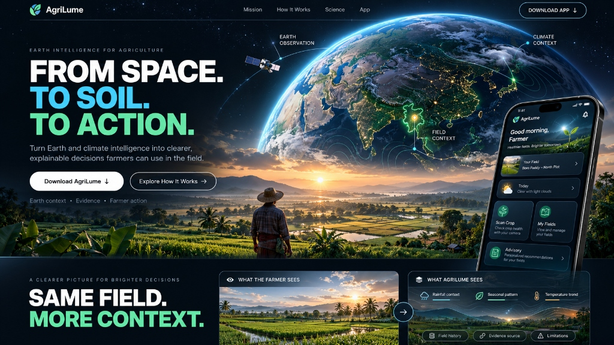
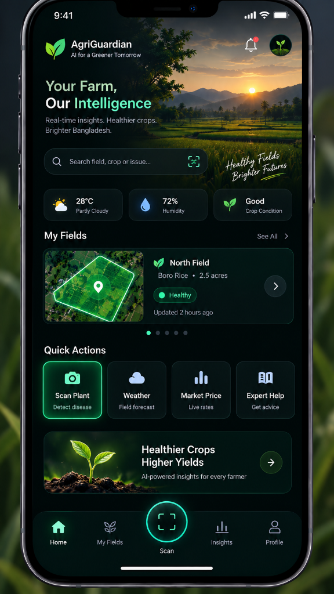
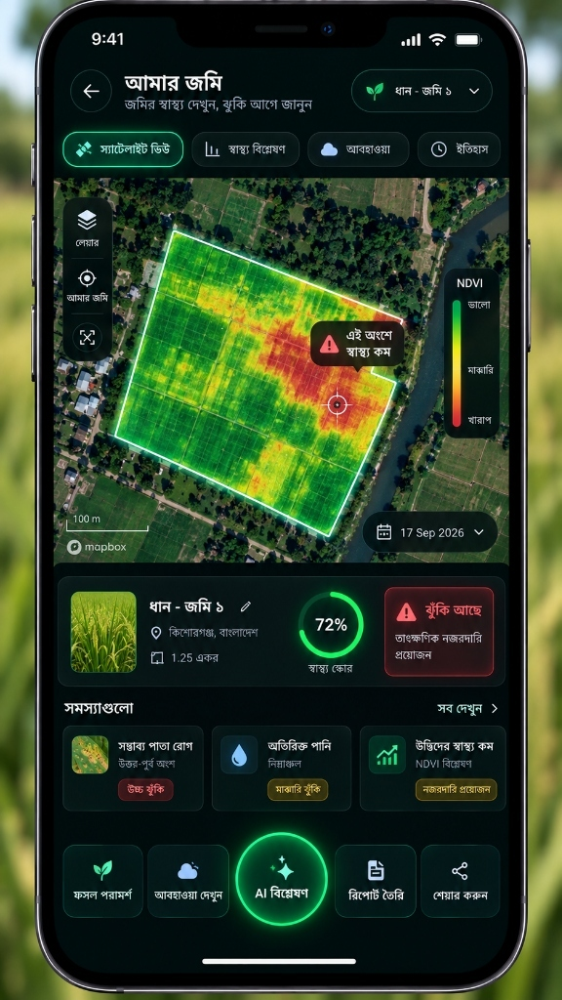
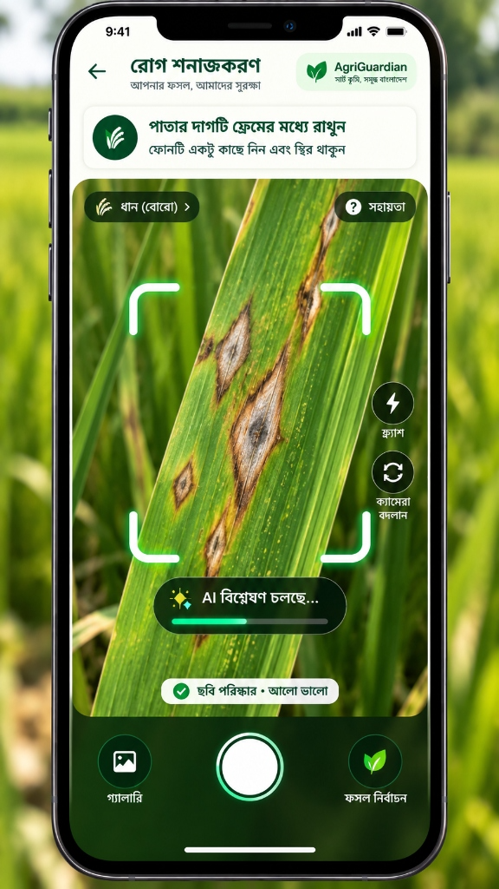

<div align="center">



# AgriLume

### FROM SPACE. TO SOIL. TO ACTION.

**Earth intelligence for better-informed farming decisions.**

A Bangladesh-focused, research-driven experience that connects NASA Earth and climate data with interactive agricultural education, explainable simulations, and accessible storytelling.

[**Explore the Web Experience**](https://agrilume-web.vercel.app/) · [**Time Travel Simulator**](https://agrilume-web.vercel.app/time-travel) · [**NASA Dataset Registry**](https://agrilume-web.vercel.app/nasa-data)


</div>

> **Project context:** AgriLume is developed as a student-led agriculture and Earth-observation project in the context of NASA Space Apps Challenge 2026. It is **not** an official NASA product, and NASA does not endorse the agricultural recommendations or simulations presented here.

---

## The mission

Farmers make decisions under uncertainty: when to plant, how to respond to heat or rainfall variability, and what changing environmental conditions may mean for a field. Satellite and climate datasets can provide context, but their resolution, uncertainty, and limitations are often difficult to communicate.

AgriLume explores a human-centered workflow:

**Earth observations → understandable evidence → scenario exploration → better-informed decisions.**

The goal is to make complex geospatial and climate information approachable for learners, students, researchers, and farming communities—without presenting educational models as measured field conditions or operational forecasts.

## Explore the project

| Experience | Route | What it offers |
| --- | --- | --- |
| Mission website | [`/`](https://agrilume-web.vercel.app/) | Project narrative, farmer challenges, Earth intelligence, interface previews, and the team |
| **Time Travel — 3D / VR** | [`/time-travel`](https://agrilume-web.vercel.app/time-travel) | Interactive Bangladeshi farm scenarios combining observed climate history and clearly labeled future simulations |
| NASA data explorer | [`/nasa-data`](https://agrilume-web.vercel.app/nasa-data) | Dataset descriptions, intended agricultural uses, limitations, and **actual integration status** |
| Bangladesh agriculture resources | [`/bangladesh-agriculture`](https://agrilume-web.vercel.app/bangladesh-agriculture) | Links to relevant official agricultural and public-information organizations |
| Circular farming | [`/recycling`](https://agrilume-web.vercel.app/recycling) | Illustrative crop-residue pathways such as compost, mulch, feed, biochar, and biogas |
| Farming game | [`/agrilume-farming-game.html`](https://agrilume-web.vercel.app/agrilume-farming-game.html) | Six educational farming stages, district selection, and browser-local progress |

The linked deployment is separate from the source repository; a route may be unavailable while deployment is in progress.

## Key capabilities

- **Interactive climate time travel.** Explore a 3D farm environment through historical climate context and explicitly labeled hypothetical futures.
- **Multiple viewing modes.** Mouse/keyboard and touch interaction, a 2D fallback, and implemented WebXR/Cardboard paths. Physical headset compatibility has not been fully verified.
- **NASA data transparency.** A registry differentiates datasets used by this web build from sources that are only cataloged or integrated in a separate companion project.
- **Explainable educational models.** Crop and water-related indicators are presented as scenarios and relative indices—not measured or guaranteed crop yields.
- **Bangla and English support.** Bilingual simulator interfaces, captions, and browser-dependent voice interaction.
- **Experimental hand controls.** Optional MediaPipe-based gesture commands; this is **not** Bangla Sign Language recognition or translation.
- **Learning through interaction.** A standalone farming game with preparation, planting, irrigation, fertilization, growth, and harvesting stages.
- **Circular agriculture.** Educational estimates showing ways crop residues might be reused instead of burned.

### Interface preview

<div align="center">
  
  &nbsp;
  
  &nbsp;
  
</div>

<p align="center"><em>Mobile app interface concepts. These images illustrate the broader AgriLume vision and do not establish that the companion app or its features are shipped by this web repository.</em></p>

## Data sources and scientific transparency

AgriLume deliberately separates **data availability**, **actual web integration**, and **simulation output**.

| Source | How this web project uses it | Important limitation |
| --- | --- | --- |
| [NASA POWER](https://power.larc.nasa.gov/) | Browser-side monthly climate-data requests; bundled real Rajshahi data supports demonstration and tests | Coarse climate grid, **not** a measurement of an individual farm |
| [NASA NEX-GDDP-CMIP6](https://registry.opendata.aws/nex-gddp-cmip6/) | Bundled SSP2-4.5 subset for Bangladesh district centers; 2033 represents a 2031–2035 mean relative to 2010–2014 | Limited two-model subset and district-center grid values; not a local forecast |
| [GPM IMERG](https://gpm.nasa.gov/data/imerg) | Listed in the dataset registry; the registry references a separate companion-backend client | **Not wired into the web simulator** |
| SMAP, FLDAS, MODIS, SRTM and other registry entries | Documented as relevant potential sources where marked `registered` | Registration does **not** mean these datasets are driving displayed values |

**How to interpret an AgriLume number**

- **Observed / bundled real:** Derived from identifiable historical data.
- **Observed-filled / cached:** An explicitly marked handling or reuse of historical observations.
- **NASA projection:** Model-based climate scenario data, not a prediction of weather on a specific day.
- **What-if / simulator:** Illustrative output produced by an educational model.

The full registry in [`lib/timetravel/nasa-datasets.ts`](lib/timetravel/nasa-datasets.ts) specifies access requirements, resolution, use cases, caveats, and integration state for each source. The [NASA data explorer](/niloy-datta/agrilume-web/tree/main/app/nasa-data) renders this information in the web app.

**Important:** No dataset count should be interpreted as a count of live integrations. Hazard visualizations are not disaster warnings, and modeled crop yield is a relative index rather than an agronomic forecast.

## Technology

| Layer | Technology |
| --- | --- |
| Application | Next.js 16 App Router, React 19, TypeScript 5 |
| Styling and interaction | Tailwind CSS 4, Framer Motion, Lucide |
| 3D / spatial experience | Three.js, React Three Fiber, Drei |
| XR support | `@react-three/xr` |
| Voice and gesture experiments | Browser speech APIs, MediaPipe Hands assets |
| Data | NASA POWER API, bundled NASA climate extracts, local dataset registry |
| Validation | Vitest, ESLint, TypeScript |
| Delivery | Next.js static export (`out/`); Vercel, Netlify, and Render configuration files |

### High-level architecture

```text
NASA POWER API ────────────┐
                           ├── Climate loading and provenance
Bundled NASA data ─────────┘               │
                                          ▼
                         Scenario and educational model
                                          │
                ┌─────────────────────────┼─────────────────────┐
                ▼                         ▼                     ▼
        3D / WebXR farm            2D fallback           Charts and explanations
                └─────────────────────────┼─────────────────────┘
                                          ▼
                           Next.js static web experience
```

This repository is the **web experience**. A separate mobile/backend implementation mentioned in the dataset registry should not be assumed to be deployed with this static site.

## Getting started

### Requirements

- **Node.js 22** (the version used by the repository's CI workflow)
- **npm**
- A modern browser; WebGL, WebXR, microphone, and camera capabilities vary by device

### Install and run

```bash
git clone https://github.com/niloy-datta/agrilume-web.git
cd agrilume-web
npm ci
npm run dev
```

Open **http://localhost:3000**.

### Available commands

| Command | Purpose |
| --- | --- |
| `npm run dev` | Local development |
| `npm run lint` | ESLint checks |
| `npm run typecheck` | TypeScript checks |
| `npm test` | Vitest unit tests |
| `npm run build` | Production build and static export to `out/` |
| `npm run build:power-fixture` | Rebuild the NASA POWER development fixture |
| `npm run start` | Next.js start script; **not** the recommended way to serve a static-export build |

The web project does **not** require a NASA API key for its NASA POWER browser requests. Other registered datasets may have different access requirements.

### Configuration and deployment

`next.config.ts` uses `output: "export"`. The generated `out/` directory can be hosted on a static-compatible platform. Deployment examples/configuration are included in `vercel.json`, `netlify.toml`, and `render.yaml`.

| Optional variable | Use |
| --- | --- |
| `NEXT_PUBLIC_BASE_PATH` | Host the app beneath a non-root URL path |
| `NEXT_PUBLIC_BUILD_SHA` | Label the demo with a traceable build revision; `GITHUB_SHA` is also supported |

For research reproducibility, record the deployed commit SHA and the exact data products used in any demo or publication.

## Repository structure

```text
app/                    Next.js pages and route entry points
components/home/        Landing-page storytelling and UI
components/timetravel/  3D scenes, simulator UI, and interactions
lib/timetravel/         Climate loading, datasets, models, accessibility
data/source/            Provenance material and source extracts
public/data/            Bundled projection data
public/images/          Project visuals and interface concepts
public/mediapipe/       Local gesture-control runtime assets
public/bdsl/            Sign-language clip verification guidance
public/                 Standalone farming-game HTML
scripts/                Data preparation and extraction scripts
tests/                  Automated unit tests
docs/                   Research and submission self-check notes
.github/workflows/      Validation and deployment workflows
```

## Current scope and limitations

This is an **educational and research prototype**, not a production agricultural advisory service.

- The Android preview is marked **COMING_SOON** in [`lib/downloads.ts`](lib/downloads.ts); this repository does not provide a downloadable APK.
- Some NASA datasets are registry entries only. Consult their precise integration states before describing them as used.
- NASA POWER's spatial resolution is much coarser than a single smallholding, and the bundled NEX-GDDP-CMIP6 projection pack covers a restricted scenario/subset.
- Crop outputs, fertilizer figures, game economics, and hazard scenes are illustrative—not recommendations for real-world farming decisions.
- WebXR and Cardboard paths exist but have not been comprehensively tested on physical headsets or across mobile devices.
- Voice availability varies by browser and language. Camera gestures require compatible hardware and browser permissions; hand gestures are not sign-language translation.
- The repository's [NASA Space Apps self-check](docs/NASA_SPACE_APPS_SELF_CHECK.md) is an **internal assessment**, not organizer approval or an official score. Competition compliance must be confirmed separately.

## Contributing and research

Issues, reproducible bug reports, accessibility feedback, and scientifically grounded suggestions are welcome. Please include the browser/device, the route, clear reproduction steps, and source citations for claims involving climate or agronomy.

Before proposing new datasets or scientific visualizations:

1. Identify the authoritative source and licensing/access requirements.
2. Document temporal/spatial resolution, uncertainty, and missing-value handling.
3. Distinguish live integration from bundled extracts, prototypes, and registry-only entries.
4. Add appropriate tests and do not display fabricated measurements as observations.

### References

- [NASA POWER](https://power.larc.nasa.gov/)
- [NASA Earthdata](https://www.earthdata.nasa.gov/)
- [NASA NEX-GDDP-CMIP6 data registry](https://registry.opendata.aws/nex-gddp-cmip6/)
- [Next.js documentation](https://nextjs.org/docs)
- [Project specification](AGRILUME_SPEC.md)
- [Research and submission self-check](docs/NASA_SPACE_APPS_SELF_CHECK.md)
- [BdSL clip verification guidance](public/bdsl/README.md)

## Team and acknowledgment

Built by the **AgriLume team**, combining software engineering, Earth-observation exploration, research, and interaction design.

Project repository maintained by [Niloy Datta](https://github.com/niloy-datta). The site includes additional contributors in its team section.

Climate data providers, NASA data products, and third-party libraries remain the work of their respective organizations and authors. Their inclusion does not imply endorsement.

**Licensing note:** No root `LICENSE` file is included in this repository at the time of writing. Public source visibility alone does not grant general reuse rights.

---

<div align="center">

**AgriLume — From Space. To Soil. To Action.**

*Making Earth intelligence more understandable, one farming decision at a time.*

[Back to top](#agrilume)

</div>
